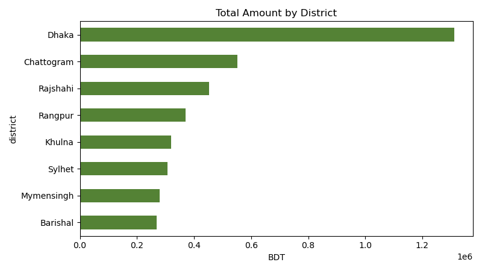
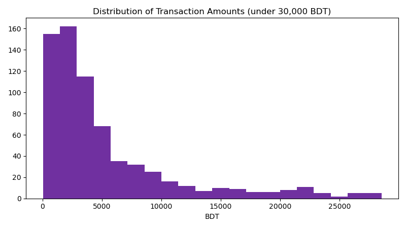
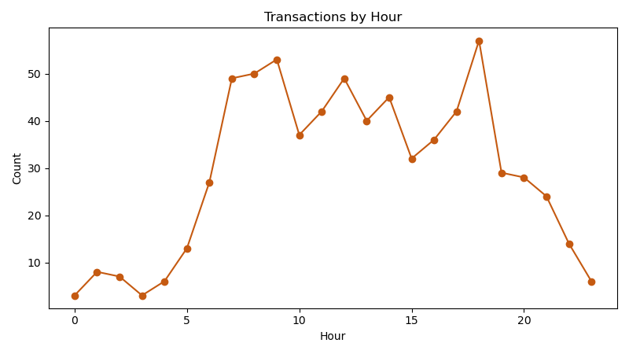
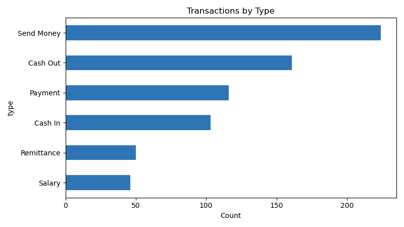

# 📱 Mobile Banking Transaction Analysis

Analyzing 700 mobile banking transactions (bKash-style) — types, amounts, fees and peak hours.

A complete beginner-friendly Data Science project built with **Python, Pandas, NumPy and Matplotlib**.
The dataset (700 transactions) is synthetic — generated with a fixed NumPy seed so anyone can reproduce it exactly.

## What's inside
- `src/generate_dataset.py` — creates the dataset in `data/`
- `src/analysis.py` — full analysis: summary tables, charts and insights
- `mobile-banking-transaction-analysis.ipynb` — Jupyter notebook version of the analysis
- `outputs/charts/` — 4 charts · `outputs/tables/` — 4 summary tables · `outputs/insights.md` — key findings
- `PROJECT_GUIDE.md` — a full beginner-friendly explanation of everything in this project

## How to run
```bash
pip install -r requirements.txt
python src/generate_dataset.py
python src/analysis.py
```

## Dataset columns
| Column | Meaning |
|---|---|
| date | Transaction date |
| hour | Hour of day (0–23) |
| type | Send Money / Cash Out / Payment / Remittance / Salary / Cash In |
| district | District |
| amount_bdt | Amount in BDT |
| fee_bdt | Fee charged in BDT |

# Key Insights — Mobile Banking Transaction Analysis

- Dataset: 700 transactions, total volume **3,861,740 BDT**.
- Most frequent transaction type: **Send Money**.
- Highest-volume district: **Dhaka**.
- Most fee income comes from: **Cash Out** (16,009 BDT in fees).
- Peak transaction hour: **18:00**.

## Charts




